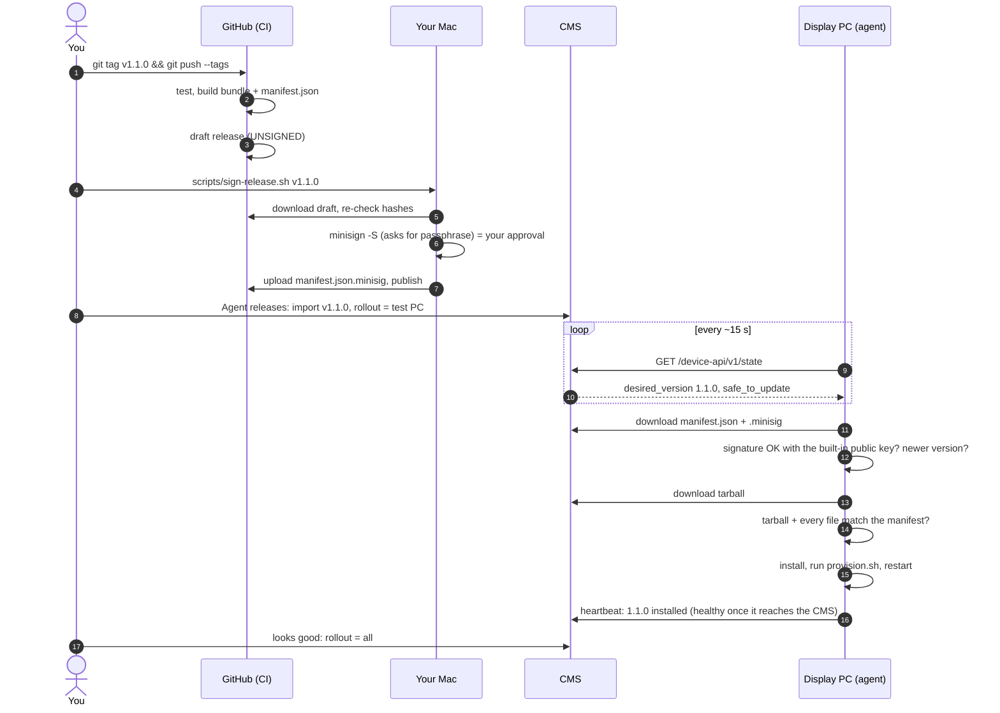

# cms-agent

The agent (`cms-arena-agent`) that runs on each arena display PC (Intel N150, Debian stable). It checks in with the CMS over mTLS, reports status, and pulls **signed** updates of itself and of the PC's configuration.

The full design (certificates, display page, stream lock-down, power, install USB) lives in the cms repo: `docs/arena-display-devices.md`. This repo implements its device side.

**Status:** the signed update pipeline is done and tested: build, sign, verify, install, health check, rollback. Still to come: enrollment with the TPM key (`cms-arena-setup`), the kiosk and splash page in `provision.sh`, display commands (reload/reboot/shutdown/screenshot), and the install USB build. These need the Phase 0 hardware.

## How an update gets from your Mac to every PC



What each check stops:

| Someone… | What happens |
|---|---|
| edits a file on the CMS server | its hash no longer matches the signed manifest → rejected |
| makes their own bundle | can't sign it without your key → rejected |
| points the CMS at an old version | anti-rollback refuses anything older, unless the release itself is a signed rollback |
| takes over your GitHub account | can publish a release, but can't sign it → rejected |
| ships a release that crashes | systemd and the health-check timer run the **previous** binary's `rollback`, and that version is never retried automatically |

The only thing that can ship code to the PCs is your signing key plus its passphrase.

## One-time setup

1. **Signing key** (on your Mac, needs `brew install minisign`). Run it in a normal Terminal window: minisign needs a real terminal to ask for the passphrase.

   ```sh
   mkdir -p ~/.minisign
   rm keys/update.pub    # the placeholder; minisign won't overwrite it
   minisign -G -p keys/update.pub -s ~/.minisign/cms-arena-agent.key
   ```

   It asks for a passphrase. Then:
   - Store `~/.minisign/cms-arena-agent.key` **and** the passphrase in the password manager. You can delete the file from the Mac and restore it only when signing.
   - Commit `keys/update.pub` (the public key; not secret). It's compiled into the agent, and CI refuses to release while it's still the placeholder.
   - Losing the key means no more updates until the PCs are re-imaged with a new public key, so keep the backup.

2. **GitHub:** this repo is **public**. That's fine: the security rests on the signing key, never on the code being secret, and nothing secret is ever committed (`*.key` is git-ignored). Keep 2FA on your account and branch protection on `main`, so nobody else can get a change into something you later sign.

## Making a release

```sh
git tag v1.1.0 && git push origin v1.1.0       # CI builds a draft release
scripts/sign-release.sh v1.1.0                 # check, sign, verify, publish
```

`sign-release.sh` shows the version and every file's hash before it asks you to sign. Afterwards it runs the exact verification a PC does.

A deliberate downgrade (e.g. 1.2.0 turned out bad and 1.1.0 must come back) is released as a **new** tag built with `--rollback`, and the PCs accept it because the signed manifest says so.

## Try it locally

```sh
go test ./...
scripts/build-release.sh v0.1.0                # dist/0.1.0/ (unsigned)
# Sign with a throwaway key to see verification work:
minisign -G -W -p /tmp/t.pub -s /tmp/t.key
minisign -S -s /tmp/t.key -m dist/0.1.0/manifest.json -t "cms-arena-agent 0.1.0"
go run ./cmd/cms-arena-agent verify --dir dist/0.1.0 --pubkey /tmp/t.pub
```

## On the PC

| Path | What |
|---|---|
| `/opt/cms-arena-agent/releases/<version>/` | extracted releases (current + previous are kept) |
| `/opt/cms-arena-agent/current`, `previous` | symlinks; systemd runs `current/cms-arena-agent run` |
| `/opt/cms-arena-agent/state/pending.json` | an update that hasn't proven healthy yet |
| `/opt/cms-arena-agent/state/failed.json` | rolled-back versions (never retried automatically; release a newer one) |
| `/etc/cms-arena-agent/config.json` | CMS URL and device cert paths, written at enrollment |

Commands (over Tailscale SSH): `cms-arena-agent version`, `verify --dir`, `apply --dir` (install a downloaded release by hand, same checks), `rollback --reason`, `healthcheck`.

## Device API used so far

Documented in full in the cms repo's plan. The agent uses:

- `GET /device-api/v1/state` → `{"agent": {"desired_version": "1.1.0", "bundle_url": "https://display.<cms-domain>/device-api/v1/bundles/1.1.0", "safe_to_update": true}}`
- `POST /device-api/v1/heartbeat` ← `{"agent_version", "hostname", "uptime_seconds", "pending_update", "failed_versions", "last_update": {"version", "status": "waiting|rejected|failed|installed", "error", "at"}}`
- `GET {bundle_url}/manifest.json`, `/manifest.json.minisig`, `/cms-arena-agent-<v>.tar.gz` (must be on the display host)

## Layout

```
cmd/cms-arena-agent   the agent (run, verify, apply, healthcheck, rollback)
cmd/bundletool        build/check bundles (CI and your Mac; never signs)
internal/minisign     minisign signature verification (prehashed ED only)
internal/bundle       manifest, build, verify, safe extraction
internal/install      releases/current/previous, provision, health, rollback
internal/agent        poll loop, mTLS client, update download
keys/update.pub       the update-signing public key (compiled in)
bundle/               what goes in every release: provision.sh + files/
scripts/              build-release.sh, sign-release.sh
```
